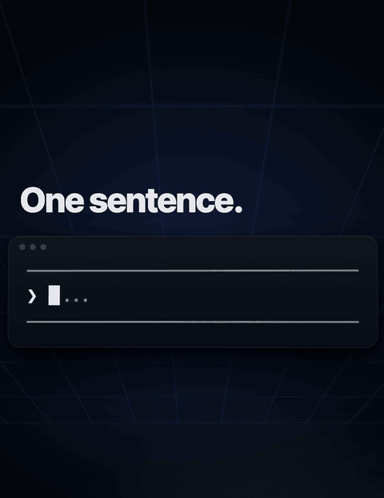

# cmpose

Generate Compose Multiplatform apps, Unity games and Ktor backends on your own machine, from any AI agent, through MCP.

**MIT licensed. No account, no API key, no server: it runs on your machine.**

<p align="center">
  
</p>

## Quick start

You need Node.js 20+ and git. Add the server to Claude Code:

    claude mcp add -s user cmpose -- npx -y @cmpose/mcp

Another MCP client? See [Use with other MCP clients](#use-with-other-mcp-clients).

Then ask your agent:

> Create a blank Compose Multiplatform app called Habits, package com.acme.habits, in ~/Projects, with Room and light/dark theming.

You get a buildable Android + iOS project on disk, generated from a tested template: `androidApp`, `iosApp` (an Xcode
project), a `shared` module with Koin and Navigation, and the Room and theming you asked for. Package, bundle id and app
name are yours throughout.

## What it generates

| Ask for | You get | Options |
|---|---|---|
| **Compose Multiplatform app** | Android + iOS, Koin, Navigation, `showcase` or `blank` template | Ktor networking, Room, DataStore, theming, multi-language, RevenueCat purchases, AdMob ads, detekt, insights (Firebase Crashlytics + Analytics), CI, a Ktor backend (Firebase sign-in, sharing), up to 3 feature modules |
| **Unity game** ("a 2D Unity game called SkyHopper with ads and leaderboards") | Unity 6 (URP), Android + iOS, a sample 2D runner or 3D track, or a blank game | Saving, multi-language, networking, RevenueCat purchases, AdMob ads, Play Games / Game Center leaderboards, insights, a visual theme, up to 3 feature modules |
| **Ktor backend** ("a backend called NotesBackend with sharing") | Firebase sign-in verified on the server, PostgreSQL with Flyway, file uploads, a sample feature to copy, the parts to deploy it as one Docker container | Sharing (spaces, roles and invitations) |

App and game options apply to the `blank` template.
Every option, tool and input: [packages/mcp/README.md](packages/mcp/README.md).
Developer guide for generated projects: https://whinstudio.github.io/cmpose/guide.html

## Building what it generates

Generating needs only Node.js and git. To build the result:

| Project | You need |
|---|---|
| Compose Multiplatform, Android | Android Studio |
| Compose Multiplatform, iOS | Xcode 16 or newer; the simulator needs an Apple Silicon Mac |
| Unity game | Unity 6 (editor 6000.3.25f1) with Android and iOS Build Support; Xcode for iOS |
| Ktor backend | JDK 21; Docker to deploy it |

## How it works

`@cmpose/mcp` is a local stdio MCP server with six tools (`cmp_describe`, `cmp_generate`, `game_describe`,
`game_generate`, `backend_describe`, `backend_generate`); `@cmpose/core` is the generator library behind it.

Generation runs entirely on your machine, with no upload. The first generation downloads the pinned template from
GitHub into `$XDG_CACHE_HOME/cmpose` when `XDG_CACHE_HOME` is set, else `~/.cache/cmpose` (override: `CMPOSE_CACHE_DIR`).
Each release pins one tag of each template, so a given version always generates the same project.

The projects you generate are yours.

## Use with Claude Code

In the quick start command, `-s user` makes the server available in every directory; without it,
it is added only for the directory you run the command in.

Optional skills for Claude Code live in [whinstudio/skills](https://github.com/whinstudio/skills):
`cmp-new-project` generates a project through this server asking only four questions, and
`cmp-feature`, `cmp-code-rules`, `cmp-testing` and others help when working in a generated
project. Install one into `~/.claude/skills/`:

    git clone https://github.com/whinstudio/skills.git
    ln -s "$PWD/skills/cmp-new-project" ~/.claude/skills/cmp-new-project

## Use with other MCP clients

Add the server to the client's `mcpServers` configuration:

```json
{
  "mcpServers": {
    "cmpose": {
      "command": "npx",
      "args": ["-y", "@cmpose/mcp"]
    }
  }
}
```

VS Code uses a slightly different file: see [packages/mcp/README.md](packages/mcp/README.md#install).

## Compatibility

From 1.0.0 the MCP tools follow semantic versioning. The current major is 2.x (2.0.0 removed the
game `uiTheme` flag). Each `@cmpose/mcp` release depends on the `@cmpose/core` release of the same
version and pins one tag of each template, so a given version always generates the same project.

- **Stable in 2.x:** the six tool names; every input field listed in
  [packages/mcp/README.md](packages/mcp/README.md#tools), its accepted values and its
  default (the `featuresConfig` keys, the game `flags`, the backend options); the fields of each
  tool's structured result.
- **A 2.x release may:** add optional fields, flags or values; accept input an earlier release
  refused; add warnings; move the pinned templates to newer tags (the release notes say what the
  generated projects gain).
- **Needs 3.0:** renaming or removing a field, flag or value; refusing input a 2.x release
  accepted; changing a default.
- **Not covered:** the contents of the generated projects (they follow the pinned templates),
  the text of warnings and errors, and `templateRef` / `backendTemplateRef` pointing at a tag
  other than the pinned one (accepted as is; an older tag may lack newer options).

## Develop

    npm install
    npm test
    npm run scan    # public hygiene scan: private paths, names, addresses, secrets

The 5 real-template tests in `packages/core/test/fileService.importSort.test.js` and the ones
in `generate.insights.real.test.js` run only when `CMP_REAL_TEMPLATE_DIR` points to a checkout of the template, e.g.
`CMP_REAL_TEMPLATE_DIR=/path/to/template-checkout npm test`; otherwise they are skipped.

`CMPOSE_BACKEND_TEMPLATE_DIR` points to a checkout of the backend template (an absolute path).
The MCP server then generates from that checkout instead of the pinned tag: `backend_generate`
and the `server/` of a `cmp_generate` blank project with the backend. Only git's tracked files
are copied, and the result warns that it is not a released tag. The real backend-template tests
in `packages/core/test/backend-generate.real.test.js` (and, together with `CMP_REAL_TEMPLATE_DIR`,
in `generate.backend.real.test.js`) run only when it is set, e.g.
`CMP_REAL_TEMPLATE_DIR=/path/to/template-checkout CMPOSE_BACKEND_TEMPLATE_DIR=/path/to/backend-template-checkout npm test`.

## License

[MIT](LICENSE)
